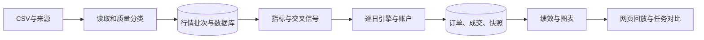

# 量化策略研究与回测平台

Python 单股票日频研究项目，覆盖 **CSV → 清洗 → 数据库 → 指标与信号 → 模拟成交 → 账户快照 → 绩效与网页回放**。

定位为本机单用户研究演示系统，不连接券商，不执行真实交易。第一至第八阶段及整体项目已由项目负责人验收。

> 当前完成版位于 **`phased-rewrite`** 分支。浏览源码或克隆时请选择此分支；仓库默认分支可能仍为早期版本。

## 快速体验（不需要 MySQL 或真实行情）

Python 3.10–3.12。以下命令在 Windows 项目根目录运行：

```powershell
git clone --branch phased-rewrite https://github.com/sunqinxue2026/quant-backtesting-system.git
cd quant-backtesting-system
python -m venv .venv
.venv\Scripts\python.exe -m pip install -e ".[test,web]"
.venv\Scripts\python.exe -I -X utf8 -m streamlit run web_app.py --server.headless=true --browser.gatherUsageStats=false
```

网页选择 **独立网页数据库**，在“数据管理”上传仓库自带的 `data/test/synthetic_pipeline_demo.csv`：来源填写 `synthetic/test`，截至日期 `2024-01-12`，口径“未复权”，勾选合成数据，单位 CNY／股／CNY。预览后导入，再进入“创建回测”，选择实际批次，设置短周期2、长周期3并运行。

新克隆仓库不包含作者本机数据库，因此首页没有历史任务是正常现象。不要将本机历史任务编号当作固定演示输入。

### 可手算的零成本命令行案例

```powershell
.venv\Scripts\python.exe -I -X utf8 scripts\run_pipeline.py --csv data/test/synthetic_pipeline_demo.csv --source synthetic/test --data-as-of 2024-01-12 --synthetic --price-type 未复权 --symbol 000001.SZ --start 2024-01-02 --end 2024-01-12 --short 2 --long 3 --cash 10000 --quantity 100 --zero-cost
```

首次导入：9条行情、2个信号、2个订单、2笔成交、9个快照，最终资产 **9700.00元**。买入11元×100股，卖出8元×100股。信号收盘后产生，下一行情日开盘尝试成交。

再次运行不要重复导入 CSV，使用第一次输出的批次编号：

```powershell
.venv\Scripts\python.exe -I -X utf8 scripts\run_pipeline.py --batch-id 1 --price-type 未复权 --symbol 000001.SZ --start 2024-01-02 --end 2024-01-12 --short 2 --long 3 --cash 10000 --quantity 100 --zero-cost
.venv\Scripts\python.exe -I -X utf8 scripts\analyze_task.py --task-id 1
```

将命令中的编号替换为实际编号。`analyze_task.py` 默认使用同一演示库，已有绩效拒绝覆盖。

## 功能与设计

| 模块 | 实现 |
|---|---|
| 数据质量 | 字段、日期、OHLC、缺失值和重复校验；accepted/review/rejected互斥分类，保留原始证据 |
| 指标策略 | SMA、EMA、收益率、滚动波动率、成交量均线；参数化双均线交叉 |
| 回测账户 | 单股票只做多、不加仓；下一行情日开盘执行、T+1、整手、资金检查 |
| 成本 | Decimal金额计算；佣金、最低佣金、卖出税及基点滑点 |
| 数据存储 | SQLAlchemy兼容SQLite/MySQL；批次、参数、信号、订单、成交、快照、绩效 |
| 绩效 | 总收益、年化、波动率、回撤、夏普、完整交易统计及价格基准 |
| 网页 | 上传清洗、参数配置、逐日回放、任务对比和教程PDF |
| 复现 | 来源摘要、已校验批次复用、新任务独立保存及数据库回读比较 |



## 源码阅读路线

1. `src/quant_system/cleaning/cleaner.py`：分类、冲突重复及数量守恒。
2. `src/quant_system/indicators/technical.py` 与 `strategies/dual_ma.py`：窗口和交叉。
3. `src/quant_system/engine/backtest.py` 与 `portfolio.py`：时间推进、成本与账户。
4. `src/quant_system/backtest_pipeline.py`、`engine/persistence.py`：编排与事务。
5. `src/quant_system/performance/`：指标、报告和存储。
6. `scripts/run_final_demo.py`：真实来源校验、批次复用和数据库回读。
7. `web_app.py`：复用业务层的Streamlit界面。

## 测试与验证

```powershell
.venv\Scripts\python.exe -I -X utf8 -m pytest -o "pythonpath=src ." -q
```

核心测试使用临时SQLite库，不写作者演示库。历史交付基线为145项通过；当前维护结果见 [开发进度](docs/PROGRESS.md)，不得将历史通过数当成本轮结果。

曾以484条真实日线完成SQLite重复运行和独立MySQL完整链路回读；这些是历史集成证据，不是每次pytest自动连接MySQL。网页MySQL写入尚无现场实测。

真实数据不随仓库分发：来源许可未核实，用户需自行提供合法数据。`run_final_demo.py`要求配套来源JSON与CSV摘要，详见 [复现与面试说明](docs/面试讲解与复现.md)。

## 数据库与安全

默认本地SQLite；需要MySQL时创建专用数据库，在本机配置 `DATABASE_URL`，并在CLI显式选择 `--database configured`。`.env.example`只是示例，代码不会自动加载`.env`。不提交密码、连接凭据、数据库、虚拟环境或生成报告。

行情导入与回测结果分别提交；回测结果的配置、任务和执行明细同事务保存。`flush()`不是`commit()`。`create_all()`用于初始化，不是已有表结构迁移工具。

## 已知限制

- 单股票、日频、只做多；没有多股票组合、部分平仓或实盘接口。
- 未完整还原交易日历、公司行动、停牌及涨跌停撮合；不能据此证明投资有效性。
- 固定股数策略与满仓无成本价格基准仓位不同，不能直接解释为超额收益。
- 文件和数据库非原子提交；同任务首次并发报告生成没有文件互斥。
- 单用户界面没有登录或公网部署加固；上传预览文件存在持续落盘问题。
- 本次审查发现的金额精度边界及卖出费用余额问题，处理方案仍待业务确认，见技术决策记录。

## 文档

- [使用教程 PDF](docs/量化研究工作台_使用教程.pdf)
- [开发计划与协作规范](docs/DEVELOPMENT_PLAN.md)
- [进度与验证记录](docs/PROGRESS.md)
- [技术决策与审查待办](docs/TECHNICAL_DECISIONS.md)
- [代码与面试知识](docs/INTERVIEW_NOTES.md)
- [Web阶段验收](docs/阶段8_Web演示界面验收.md)
- [完整链路历史验收](docs/阶段7_完整验证与最终验收.md)

更早阶段的设计和验收记录保存在 `docs/`，其中测试数量、任务编号和阶段状态均为当时记录。
